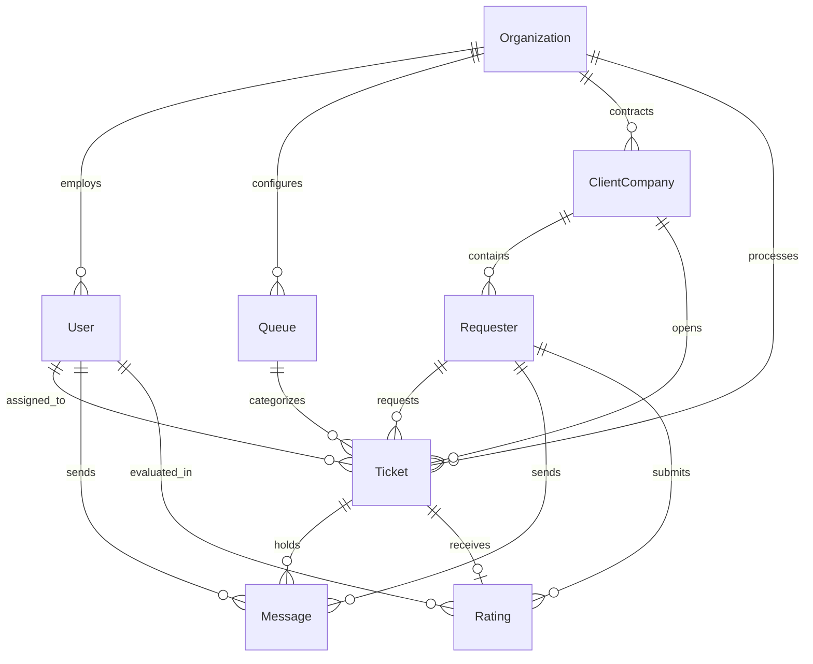

# Data Model Specification

**Feature**: Multi-Tenant Corporate Helpdesk and Remote Control Core Platform  
**Branch**: `001-multi-tenant-helpdesk-core`  
**Date**: 2026-11-05  

---

## 1. Entity-Relationship Overview

---

## 2. Entities & Schema Details

### 2.1. Organization (`core/.../organization/`)
- `id`: `OrganizationId` (UUID v4)
- `name`: string (min 2, max 255 chars)
- `documentNumber`: string (unique fiscal identifier)
- `maxConcurrentTickets`: number (contracted concurrent ticket capacity)
- `isActive`: boolean (default `true`)
- `createdAt`: DateTime
- `updatedAt`: DateTime

### 2.2. User (`core/.../identity/user/`)
- `id`: `UserId` (UUID v4)
- `organizationId`: `OrganizationId`
- `name`: string
- `email`: string (unique per organization)
- `passwordHash`: string (Argon2id/Bcrypt)
- `role`: enum (`ADMIN`, `SUPERVISOR`, `AGENT`)
- `status`: enum (`ONLINE`, `BUSY`, `AWAY`, `OFFLINE`)

### 2.3. ClientCompany (`core/.../customer/client-company/`)
- `id`: `ClientCompanyId` (UUID v4)
- `organizationId`: `OrganizationId`
- `corporateName`: string
- `tradeName`: string
- `documentNumber`: string
- `maxConcurrentSessions`: number (default 5)
- `isActive`: boolean (default `true`)
- `licenseExpiresAt`: DateTime (optional)

### 2.4. Requester (`core/.../customer/requester/`)
- `id`: `RequesterId` (UUID v4)
- `clientCompanyId`: `ClientCompanyId`
- `name`: string
- `email`: string
- `phone`: string (optional)
- `machineHostname`: string (optional)

### 2.5. Queue (`core/.../helpdesk/queue/`)
- `id`: `QueueId` (UUID v4)
- `organizationId`: `OrganizationId`
- `name`: string
- `priority`: number (1 = normal, 2 = high, 3 = urgent)
- `isActive`: boolean

### 2.6. Ticket (`core/.../helpdesk/ticket/`)
- `id`: `TicketId` (UUID v4)
- `organizationId`: `OrganizationId`
- `protocolNumber`: string (unique, format `TCK-YYYYMMDD-XXXX`)
- `clientCompanyId`: `ClientCompanyId`
- `requesterId`: `RequesterId`
- `queueId`: `QueueId`
- `agentId`: `UserId` (optional until claimed)
- `status`: enum (`WAITING_QUEUE`, `IN_PROGRESS`, `PAUSED`, `RESOLVED`, `CLOSED`, `CANCELLED`)
- `activeChannel`: enum (`CHAT_ONLY`, `VOICE_CALL`, `VIDEO_CALL`, `SCREEN_SHARE`, `REMOTE_CONTROL`)
- `enteredQueueAt`: DateTime (default now)
- `claimedAt`: DateTime (optional)
- `resolvedAt`: DateTime (optional)
- `closedAt`: DateTime (optional)
- `queueWaitTimeSec`: number (computed on claim)
- `totalDurationSec`: number (computed on resolution)

### 2.7. Message (`core/.../helpdesk/message/`)
- `id`: `MessageId` (UUID v4)
- `ticketId`: `TicketId`
- `senderType`: enum (`AGENT`, `REQUESTER`, `SYSTEM`)
- `userId`: `UserId` (optional)
- `requesterId`: `RequesterId` (optional)
- `type`: enum (`TEXT`, `AUDIO`, `SCREEN_CAPTURE`, `IMAGE`, `VIDEO`)
- `content`: string (text or description)
- `mediaUrl`: string (S3 object URL)
- `mediaMetadata`: JSON (`{ durationSec, mimeType, sizeBytes, width, height }`)
- `createdAt`: DateTime

### 2.8. Rating (`core/.../helpdesk/rating/`)
- `id`: `RatingId` (UUID v4)
- `ticketId`: `TicketId` (unique 1:1 relation)
- `requesterId`: `RequesterId`
- `agentId`: `UserId`
- `score`: number (integer between 1 and 5)
- `feedback`: string (optional)
- `createdAt`: DateTime
